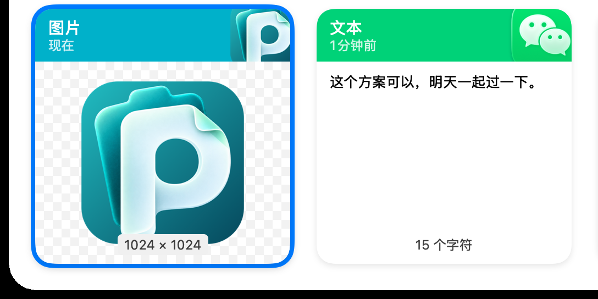
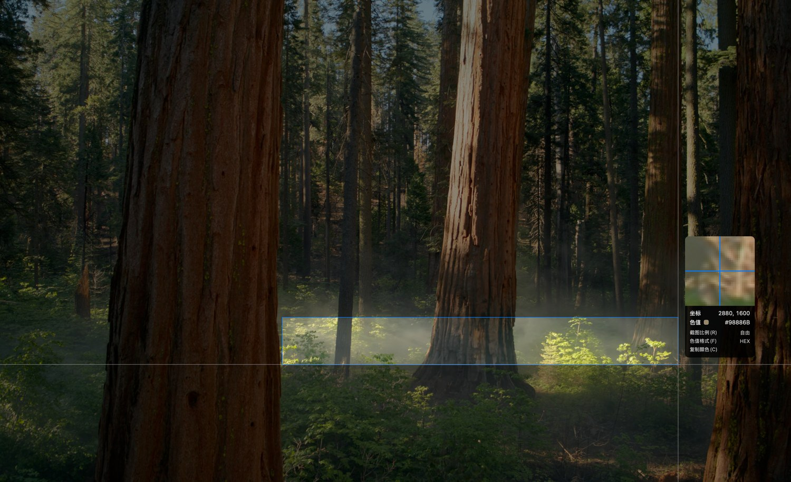
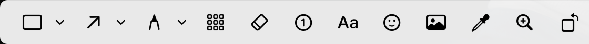
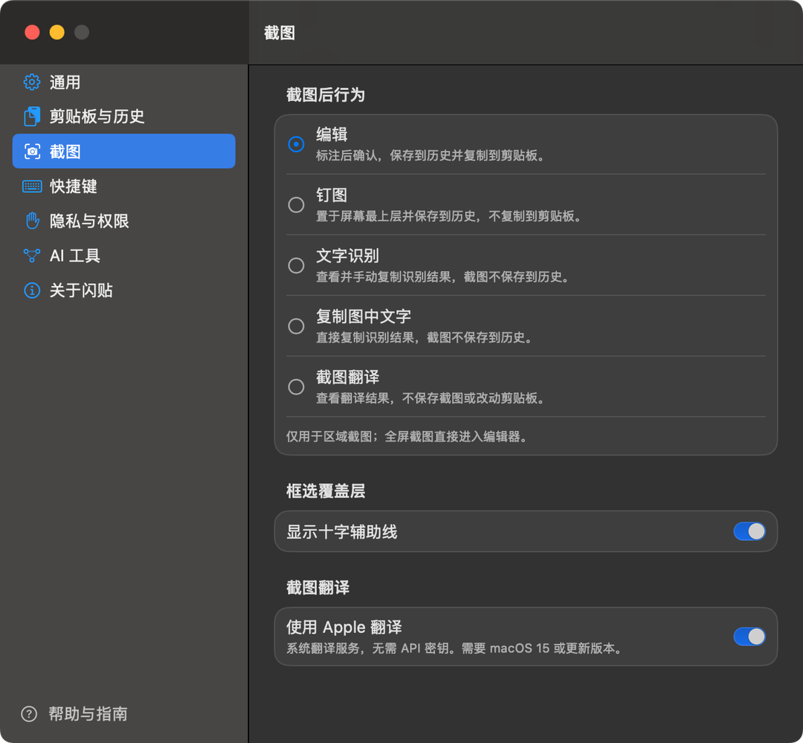
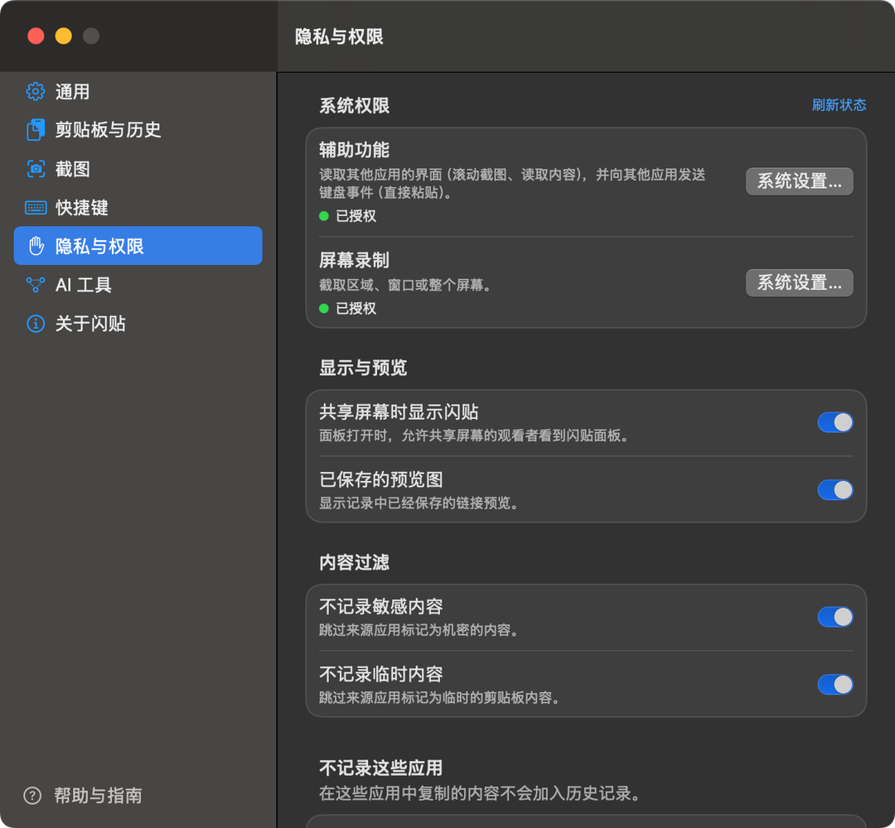

# BlinkClip (闪贴)

**Everything you copy stays findable, and every screenshot is ready to annotate.** BlinkClip is a local-first clipboard history and screenshot tool for macOS: text, images, files, links and colours land in one searchable card panel, `⌘⇧A` opens the annotation editor right after a region capture, and any screenshot can be pinned on top of your screen while you work.

<p>
  <a href="https://github.com/aexachao/BlinkClip/actions/workflows/release.yml"></a>
  <a href="https://github.com/aexachao/BlinkClip/releases/latest"></a>
  <a href="LICENSE"></a>
</p>

**macOS 14+** · Universal installer (Intel and Apple silicon) · **Local first**, your history stays on your Mac · **No account needed**

<p>
  <a href="https://github.com/aexachao/BlinkClip/releases/latest"></a>
</p>

<!-- blinkclip-download:start -->
Current stable version: **1.0.32**. One installer supports Intel and Apple silicon:

[Download BlinkClip-1.0.32-macos-universal.dmg](https://github.com/aexachao/BlinkClip/releases/download/v1.0.32/BlinkClip-1.0.32-macos-universal.dmg)
<!-- blinkclip-download:end -->

## Screenshots

<table>
  <tr>
    <td colspan="2" align="center"></td>
  </tr>
  <tr>
    <td colspan="2" align="center"><sub>Clipboard history panel — demo data shown</sub></td>
  </tr>
  <tr>
    <td colspan="2" align="center"></td>
  </tr>
  <tr>
    <td colspan="2" align="center"><sub>Selection overlay: crosshair guides + selection + magnifier readouts</sub></td>
  </tr>
  <tr>
    <td colspan="2" align="center"></td>
  </tr>
  <tr>
    <td colspan="2" align="center"><sub>Annotation editor toolbar, opened right after a capture</sub></td>
  </tr>
  <tr>
    <td width="50%" align="center"></td>
    <td width="50%" align="center"></td>
  </tr>
  <tr>
    <td align="center"><sub>Settings → Screenshots</sub></td>
    <td align="center"><sub>Settings → Privacy &amp; Permissions</sub></td>
  </tr>
</table>

## Features

### Clipboard history

Copy anything and it lands in the panel; `⇧⌘V` opens it from any app.

| Capability | Details |
| --- | --- |
| Item types | Text, images, files, links, colours; original representations kept (rich text, HTML, file URLs) |
| Browsing | Horizontal card panel with multi-select, preview and in-place editing |
| Finding | Keyword search, plus filters by type, source app and date |
| Retention | 1 / 3 / 7 / 15 / 30 / 60 days or forever; only items that expired *and* are not in a collection get purged |
| Paste modes | Paste straight into the current app, copy back to the clipboard, or always paste as plain text |
| Archive | Import and export your own JSON archive |

### Collections and Stack

| Capability | Details |
| --- | --- |
| Collections (Pinboard) | Pin the items you reuse; names, colours, order and membership can sync |
| BlinkClip Stack | Queue several items and paste them in order with `⇧⌘C` — handy for forms and repetitive work |

### Screenshots and annotation

| Capability | Details |
| --- | --- |
| Capture | `⌘⇧A` for a region, `⌘⇧E` for the full screen; both open the annotation editor directly. While selecting, full-screen crosshair guides and a magnifier follow the pointer |
| Annotation tools | Rectangle, ellipse, arrow, line, pen, marker, spotlight, mosaic, eraser, magnifier, numbered markers, text, QR code, emoji, insert image, colour picker |
| Scrolling capture | Long screenshots are stitched for you: automatic scrolling needs Accessibility access, manual scrolling does not. A crop step runs before returning to the editor |
| Pin to screen | Keep a screenshot floating above your work for reference |
| Text recognition | Local Vision OCR; you can copy just the text and skip keeping the image |
| Translation | Apple Translation (macOS 15+), enabled in **Settings → Screenshots** |
| After capture | Edit / pin / recognise text / copy text from image / translate, chosen in **Settings → Screenshots** |

### AI tool integration (MCP)

`blinkclip-mcp` is a standard stdio JSON-RPC service that hands your clipboard history to Claude, Codex, Cursor and similar tools as context; **Settings → AI tools** copies the configuration for you.

| Capability | Details |
| --- | --- |
| Items | `search`, `read_item`, `create_item`, `update_item`, `delete_item` |
| Collections | `list_pinboards`, `create_pinboard`, `rename_pinboard`, `delete_pinboard`, `add_item_to_pinboard`, `remove_item_from_pinboard` |
| Transport | Local stdio, no listening port; `create_item(list_id)` only adds a collection item and never touches the system clipboard |

### Sync (iCloud)

| Capability | Details |
| --- | --- |
| Default state | **Off.** Turned on in **Settings → General → iCloud Sync**; every Mac signs in with the same Apple ID |
| CloudKit | Properly signed builds sync history and collections through BlinkClip's own iCloud container — **live in production** |
| iCloud Drive | Builds without the CloudKit entitlement fall back to iCloud Drive file sync (`iCloud Drive/BlinkClip`) |
| Mutual exclusion | Only one backend runs at a time; turning sync off keeps both local content and cloud data |
| Synced data | Item content, original formats, images, source apps and collection membership; shortcuts, permissions, exclusion lists, retention and the Stack queue stay local |

### Keyboard shortcuts

Defaults below; everything is configurable in **Settings → Shortcuts**:

| Action | Default shortcut |
| --- | --- |
| Open the history panel | `⇧⌘V` |
| Stack sequential paste | `⇧⌘C` |
| Region capture | `⌘⇧A` |
| Full-screen capture | `⌘⇧E` |

## Install

1. Open the [latest release](https://github.com/aexachao/BlinkClip/releases/latest) and download `BlinkClip-<version>-macos-universal.dmg`; the same installer supports Intel and Apple silicon.
2. Open the DMG, drag `BlinkClip.app` into `Applications`, then launch it from there.
3. Grant the permissions it asks for on first use (see below), then press `⇧⌘V` in any app to open the panel.
4. To keep it running after login, enable **Launch at login** in **Settings → General**.

The installer is Developer ID signed, notarized by Apple with the ticket stapled, so it opens with a normal double-click. Signing and checksum details are in each release's notes.

### Permissions

| Permission | Why it is needed | Where to grant it |
| --- | --- | --- |
| Accessibility | Read other apps' interface (scrolling capture, reading content) and send keyboard events to other apps (direct paste) | System Settings → Privacy & Security → Accessibility; the app's **Settings → Privacy & Permissions** pane links straight there |
| Screen Recording | Capture a region, a window, or the whole screen | System Settings → Privacy & Security → Screen Recording; also linked from the app |
| Send events | Delivers the keyboard events of a direct paste. It comes from the same grant as Accessibility, so System Settings never lists it separately | Covered by the Accessibility grant; if the app reports it as not ready, re-tick Accessibility and relaunch |

Nothing is blocked without them: features that do not need Accessibility keep working, and scrolling capture can be done with manual scrolling.

### Updates

In-app updates are provided by [Sparkle](https://sparkle-project.org). **About BlinkClip → Check for Updates** compares against the latest stable GitHub Release, reusing a result for six hours. After you confirm, Sparkle downloads the complete Universal DMG inside the app, verifies the Ed25519 signatures on the update feed and the archive, saves local data through the normal quit flow, installs and relaunches. The check only requests public release information and can be retried offline. **macOS may ask you to grant Accessibility again after an update.** See the [in-app updates guide](docs/APP_UPDATES.md).

## Privacy

- **Local first**: clipboard history, screenshots and settings stay on your Mac by default. Sync is off by default, and no account is required.
- **Where the data lives**: `~/Library/Application Support/BlinkClip/` (directory `0700`, database `0600`). On first launch an older `clipboard.json` is migrated into `clipboard.sqlite`; the original file is kept, never overwritten.
- **Nothing leaves unless you enable sync**: content then goes to iCloud under your own Apple ID (the CloudKit container or the `iCloud Drive/BlinkClip` folder), not to any server of ours. The app reports no usage data either.
- **Sensitive content is skipped**: clipboard items that the source app marks as confidential or transient are ignored, and you can exclude specific apps in **Settings → Privacy & Permissions**.
- **Redact before reporting**: screenshots, logs and archives can contain personal data. Reproduce problems with fictional text and temporary files, and never submit real history, accounts or keys.

## Build from source

You need macOS 14+, Xcode 26 or newer Command Line Tools (the Swift toolchain) and Python 3. **The first build downloads and verifies a checksum-pinned Sparkle framework through SwiftPM.**

From the repository root, build a Universal app — the output is `out/BlinkClip.app`:

```sh
bash replica/scripts/build-app.sh release universal
```

For a debug build of the current Mac only:

```sh
bash replica/scripts/build-app.sh debug native
```

To package a release-format Universal DMG:

```sh
npm run build:dmg
```

Generating the signed update feed for a stable release needs the release private key configured outside the repository; that command only packages locally and never publishes. If this Mac has a valid Apple Development identity, set `BLINKCLIP_SIGNING_IDENTITY` to its name or certificate SHA-1; without it builds use ad-hoc signing, and a signing change usually means granting Accessibility again.

More development notes are in [replica/README.md](replica/README.md) and the [testing notes](replica/TESTING.md).

## Project layout

```
replica/Sources/BlinkClip       App: panel, settings, capture flow, sync and updates
replica/Sources/BlinkClipCore   UI-free core: storage, archives, clipboard model, shortcuts
replica/Sources/BlinkClipMCP    The blinkclip-mcp stdio service
replica/Sources/BlinkClipHelper Login item helper
replica/Vendor/capcap           Capture overlay and annotation editor (third-party, MIT)
scripts/                        Release-download sync and website checks
docs/                           Testing, sync, CloudKit and update notes
website/                        Project home page
```

## Known limitations

- **Cross-app direct paste** depends on the Accessibility grant and has not been verified in every app or at every caret position; for edge cases use "copy to clipboard" and paste manually.
- **CloudKit** is live in production and was validated against the real service with two isolated clients on one Mac; full acceptance with **two physical Macs, real network disconnection and iCloud Drive arrival on another device** is still in progress and should not be read as passed item by item.
- The **screen recording entry** exists in the interface; whether it works is not yet verified.
- There is no iPhone or iPad app; sync is between Macs only.
- The app ships Developer ID signed without App Sandbox, outside the Mac App Store.

## Contributing

Issues and pull requests are welcome — see [CONTRIBUTING.md](CONTRIBUTING.md) for the workflow, and the [changelog](CHANGELOG.md) for release history. When reporting a problem, include reproduction steps without private content.

## License

The independently written implementation, tools, documentation and self-made graphics are open source under [GNU AGPL-3.0](LICENSE), including its section 13 network-use clause. Third-party components keep their own licenses and copyright notices; see [NOTICE.md](NOTICE.md) for the scope of each part.

## Credits

- [capcap](https://github.com/realskyrin/capcap) (Copyright © 2026 realskyrin) — the capture overlay and annotation editor module, included under the MIT license.
- [Sparkle](https://sparkle-project.org) — the in-app update framework.
- And the AppKit / SwiftUI / Swift documentation and discussions we keep coming back to.
