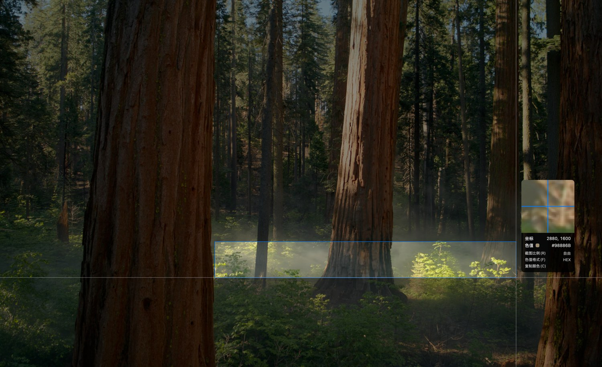
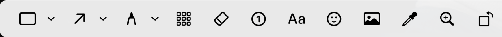
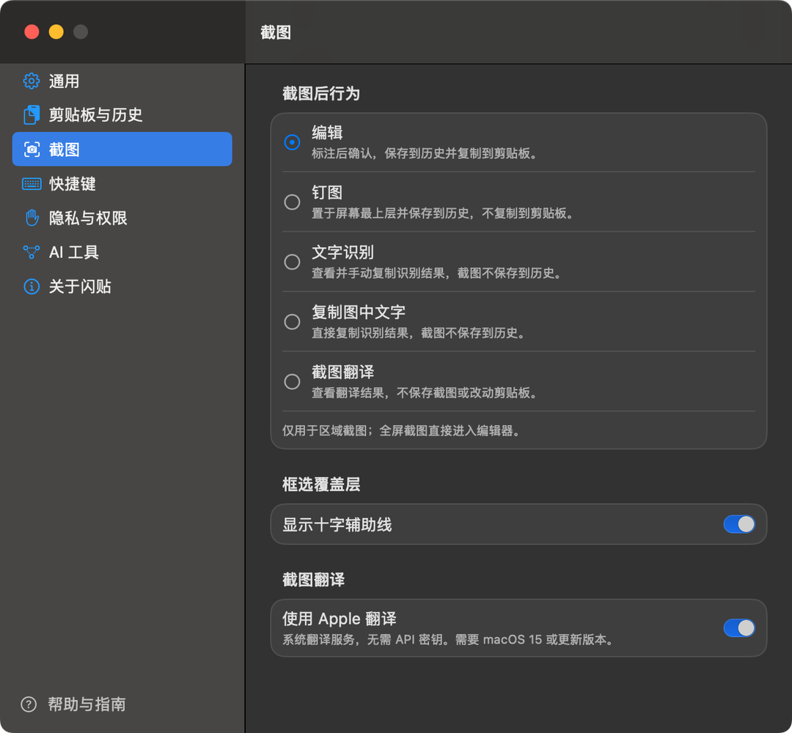
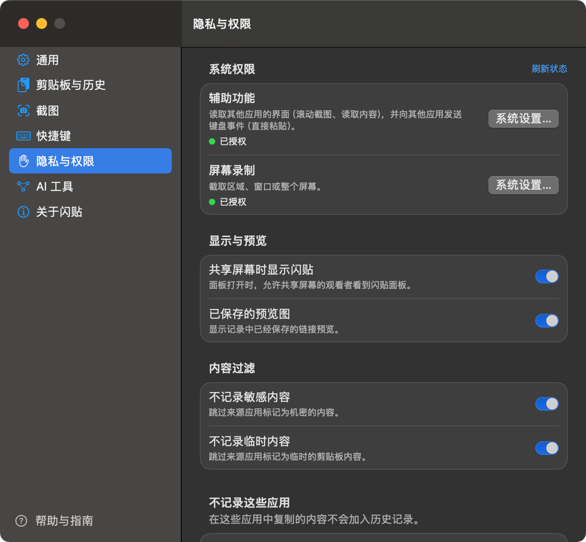

# 闪贴 / BlinkClip

**复制过的东西都找得回来，截完图直接标注。** 闪贴是一款本地优先的 macOS 剪贴板历史与截图工具：文本、图片、文件、链接和颜色都收进一个可搜索的卡片面板，`⌘⇧A` 框选后直接进入标注编辑器，需要对照时还能把截图钉在屏幕上。

<p>
  <a href="https://github.com/aexachao/BlinkClip/actions/workflows/release.yml"></a>
  <a href="https://github.com/aexachao/BlinkClip/releases/latest"></a>
  <a href="LICENSE"></a>
</p>

**macOS 14+** · Universal 安装包（Intel 与 Apple 芯片）· **本地优先**，历史只存在本机 · **无需账号**

<p>
  <a href="https://github.com/aexachao/BlinkClip/releases/latest"></a>
</p>

<!-- blinkclip-download:start -->
当前正式版 **1.0.33**，一个安装包兼容 Intel 与 Apple 芯片：

[下载 BlinkClip-1.0.33-macos-universal.dmg](https://github.com/aexachao/BlinkClip/releases/download/v1.0.33/BlinkClip-1.0.33-macos-universal.dmg)
<!-- blinkclip-download:end -->

## 截图

<table>
  <tr>
    <td colspan="2" align="center"></td>
  </tr>
  <tr>
    <td colspan="2" align="center"><sub>剪贴板历史面板 —— 图为演示数据</sub></td>
  </tr>
  <tr>
    <td colspan="2" align="center"></td>
  </tr>
  <tr>
    <td colspan="2" align="center"><sub>框选覆盖层：十字辅助线 + 选区 + 放大镜读数</sub></td>
  </tr>
  <tr>
    <td colspan="2" align="center"></td>
  </tr>
  <tr>
    <td colspan="2" align="center"><sub>截图后的标注编辑器工具栏</sub></td>
  </tr>
  <tr>
    <td width="50%" align="center"></td>
    <td width="50%" align="center"></td>
  </tr>
  <tr>
    <td align="center"><sub>设置 → 截图</sub></td>
    <td align="center"><sub>设置 → 隐私与权限</sub></td>
  </tr>
</table>

## 功能

### 剪贴板历史

复制即入库，`⇧⌘V` 从任何应用呼出面板。

| 能力 | 说明 |
| --- | --- |
| 收录类型 | 文本、图片、文件、链接、颜色；保留原始 representation（富文本、HTML、文件 URL） |
| 浏览 | 横向卡片面板，多选、预览、本地编辑 |
| 查找 | 关键字搜索，按类型、来源应用、日期筛选 |
| 保留期限 | 1 / 3 / 7 / 15 / 30 / 60 天或永久；只清理过期且未加入分组的内容 |
| 粘贴方式 | 直接粘贴到当前应用、复制回剪贴板、始终以纯文本粘贴 |
| 归档 | 自有 JSON 归档导入与导出 |

### 收藏与 Stack

| 能力 | 说明 |
| --- | --- |
| 收藏分组（Pinboard） | 把常用内容钉进分组；分组名称、颜色、顺序与成员关系可同步 |
| BlinkClip Stack | 把多条内容排成队列，`⇧⌘C` 按顺序依次粘贴，适合填表与重复录入 |

### 截图与标注

| 能力 | 说明 |
| --- | --- |
| 截图 | `⌘⇧A` 区域截图、`⌘⇧E` 全屏截图，都直接进入标注编辑器；框选时显示贯穿全屏的十字辅助线与放大镜 |
| 标注工具 | 矩形、椭圆、箭头、直线、画笔、马克笔、聚光灯、马赛克、橡皮、放大镜、序号、文字、二维码、表情、插入图片、取色 |
| 长截图 | 滚动截图自动拼接：自动滚动需要辅助功能授权，手动滚动不需要；结束后先裁剪再回到编辑器 |
| 钉图 | 把截图以浮窗钉在屏幕最上层，随时对照 |
| 文字识别 | 本地 Vision OCR，可只取文字、不留截图 |
| 翻译 | Apple 翻译（macOS 15+），在「设置 → 截图」开启 |
| 截图后行为 | 编辑 / 钉图 / 文字识别 / 复制图中文字 / 截图翻译，在「设置 → 截图」选择 |

### AI 工具接入（MCP）

`blinkclip-mcp` 是标准 stdio JSON-RPC 服务，可把剪贴板历史交给 Claude、Codex、Cursor 等 AI 工具当上下文；「设置 → AI 工具」里能直接复制配置。

| 能力 | 说明 |
| --- | --- |
| 条目 | `search`、`read_item`、`create_item`、`update_item`、`delete_item` |
| 分组 | `list_pinboards`、`create_pinboard`、`rename_pinboard`、`delete_pinboard`、`add_item_to_pinboard`、`remove_item_from_pinboard` |
| 传输 | 本地 stdio，不监听端口；`create_item(list_id)` 只建分组项目，不动系统剪贴板 |

### 同步（iCloud）

| 能力 | 说明 |
| --- | --- |
| 默认状态 | **关闭**。入口是「设置 → 通用 → iCloud 同步」，多台 Mac 需登录同一 Apple ID |
| CloudKit | 正式签名版经自有 iCloud 容器同步历史与分组，**生产环境已上线** |
| iCloud Drive | 未获 CloudKit 授权的构建回退为 iCloud Drive 文件同步（`iCloud Drive/BlinkClip`） |
| 互斥 | 两条路径同时只开一条；关闭同步保留本地内容与云端数据 |
| 同步范围 | 项目内容、原始格式、图片、来源应用与分组关系；快捷键、权限、排除列表、保留期限与 Stack 队列不同步 |

### 快捷键

默认值如下，全部可在「设置 → 快捷键」修改：

| 操作 | 默认快捷键 |
| --- | --- |
| 打开历史面板 | `⇧⌘V` |
| Stack 顺序粘贴 | `⇧⌘C` |
| 区域截图 | `⌘⇧A` |
| 全屏截图 | `⌘⇧E` |

## 安装

1. 打开 [最新发布](https://github.com/aexachao/BlinkClip/releases/latest)，下载 `BlinkClip-<版本>-macos-universal.dmg`；同一个安装包同时支持 Intel 与 Apple 芯片。
2. 打开 DMG，把 `BlinkClip.app` 拖入 `Applications`，再从应用程序文件夹启动。
3. 首次使用时按引导授予必要权限（见下表），然后在任意应用里按 `⇧⌘V` 呼出面板。
4. 需要开机常驻时，在「设置 → 通用」打开「登录时打开」。

安装包由 Developer ID 签名并通过 Apple 公证、票据已装订，可直接双击运行；签名与校验信息见各次 Release 说明。

### 权限

| 权限 | 为什么需要 | 在哪里授予 |
| --- | --- | --- |
| 辅助功能 | 读取其他应用界面（滚动截图、读取内容），并向其他应用发送键盘事件（直接粘贴） | 系统设置 → 隐私与安全性 → 辅助功能；也可从「设置 → 隐私与权限」点「系统设置…」 |
| 屏幕录制 | 截取区域、窗口或整个屏幕 | 系统设置 → 隐私与安全性 → 屏幕录制；同样可从应用内跳转 |
| 发送事件 | 直接粘贴时向目标应用投递键盘事件。它与辅助功能同源，系统设置不会单独列出这一项 | 随辅助功能一并生效；若提示未就绪，重新勾选辅助功能后重启应用 |

不授予也能用：不依赖辅助功能的项目照常工作，滚动截图可改用手动滚动。

### 更新

应用内更新由 [Sparkle](https://sparkle-project.org) 提供。在「关于闪贴 → 检查更新」对比最新正式 Release，六小时内复用检查结果；确认后应用内下载完整 Universal DMG，校验更新源与安装包的 Ed25519 签名，走既有退出流程保存数据后安装并重启。检查只请求公开版本信息，离线或失败可重试。**更新后系统可能要求重新授予辅助功能权限。** 细节见[应用内更新说明](docs/APP_UPDATES.md)。

## 隐私

- **本地优先**：剪贴板历史、截图与设置默认只保存在本机；同步默认关闭，不需要账号。
- **数据位置**：`~/Library/Application Support/BlinkClip/`（目录 `0700`，数据库 `0600`）。首次启动会把旧的 `clipboard.json` 迁移进 `clipboard.sqlite`，原文件保留不覆盖。
- **开启同步才会上云**：内容进入你自己 Apple ID 下的 iCloud（CloudKit 容器或 `iCloud Drive/BlinkClip` 目录），不经过本项目的服务器；应用也不上报使用数据。
- **敏感内容不记录**：来源应用标记为机密或临时的剪贴板内容会被跳过；也可以在「设置 → 隐私与权限」里指定不记录的应用。
- **报告问题前先脱敏**：截图、日志与归档可能含有个人信息，请用虚构文本和临时文件复现，不要提交真实历史、账号或密钥。

## 从源码构建

需要 macOS 14+、Xcode 26 或更新版本的 Command Line Tools（Swift 工具链）与 Python 3。**首次构建会通过 SwiftPM 下载并校验固定版本的 Sparkle 框架。**

从仓库根目录构建 Universal 应用，产物为 `out/BlinkClip.app`：

```sh
bash replica/scripts/build-app.sh release universal
```

只构建当前 Mac 的调试版：

```sh
bash replica/scripts/build-app.sh debug native
```

制作正式发布格式的 Universal DMG：

```sh
npm run build:dmg
```

生成稳定版本的签名更新源需要项目外配置的发布私钥；上面这条命令只在本地打包，不发布。已有有效 Apple Development 身份时，可把环境变量 `BLINKCLIP_SIGNING_IDENTITY` 设为身份名称或证书 SHA-1；未设置时采用临时签名，签名变化后通常需要重新授予辅助功能权限。

更多开发说明见 [replica/README.md](replica/README.md) 与[测试说明](replica/TESTING.md)。

## 项目结构

```
replica/Sources/BlinkClip        App：面板、设置、截图流程、同步与更新
replica/Sources/BlinkClipCore    与界面无关的核心：存储、归档、剪贴板模型、快捷键
replica/Sources/BlinkClipMCP     blinkclip-mcp stdio 服务
replica/Sources/BlinkClipHelper  登录项 Helper
replica/Vendor/capcap            截图覆盖层与标注编辑器（第三方，MIT）
scripts/                         发布下载同步与网站校验
docs/                            测试、同步、CloudKit、应用内更新说明
website/                         项目主页
```

## 已知限制

- **跨应用直接粘贴**依赖辅助功能授权，尚未在所有应用与全部光标位置验证通过；边界应用请改用「复制到剪贴板」再手动粘贴。
- **CloudKit** 已在生产环境上线，并通过同一台 Mac 上双客户端对真实服务的读写验证；**物理双机、真实断网重连与 iCloud Drive 跨设备到达**的完整验收仍在进行，不能当作已逐项通过。
- **录屏入口**在界面中存在，实际可用性尚未验证。
- 暂无 iPhone / iPad 版；同步只在 macOS 之间进行。
- 采用 Developer ID 直接分发、未启用 App Sandbox，不走 Mac App Store。

## 参与贡献

欢迎提交 Issue 与 Pull Request，流程与规范见 [CONTRIBUTING.md](CONTRIBUTING.md)；发布历史见[更新日志](CHANGELOG.md)。报告问题时请附不含隐私的复现步骤。

## 许可

独立编写的实现源码、工具、文档与自制图形按 [GNU AGPL-3.0](LICENSE) 开源（含第 13 条网络使用条款）。第三方组件保留各自的许可与版权声明，范围见 [NOTICE.md](NOTICE.md)。

## 致谢

- [capcap](https://github.com/realskyrin/capcap)（Copyright © 2026 realskyrin）—— 截图覆盖层与标注编辑器模块，MIT 许可引入。
- [Sparkle](https://sparkle-project.org) —— 应用内更新框架。
- 以及 AppKit / SwiftUI / Swift 社区里那些被反复查阅的文档与讨论。
